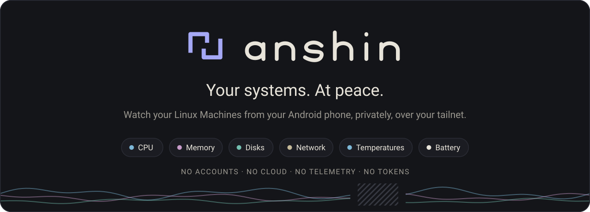
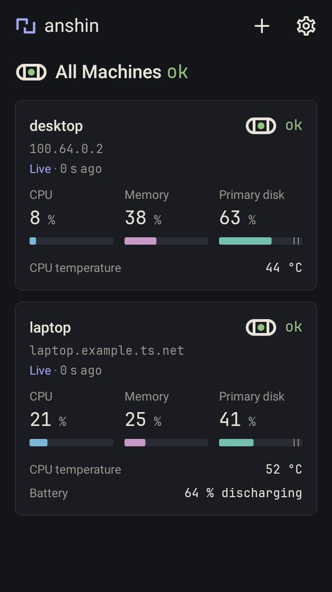
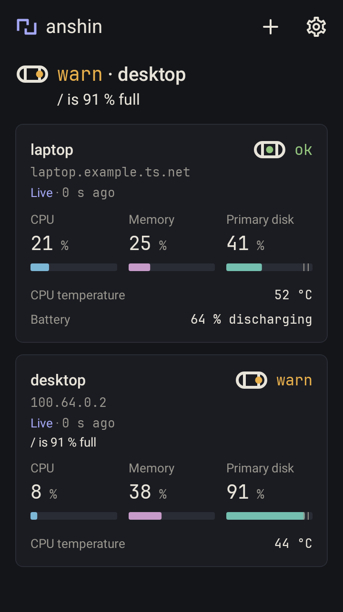
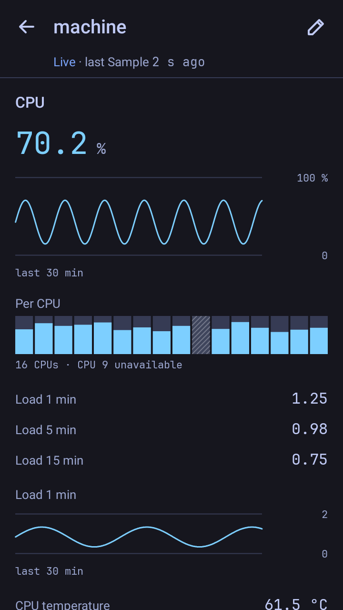
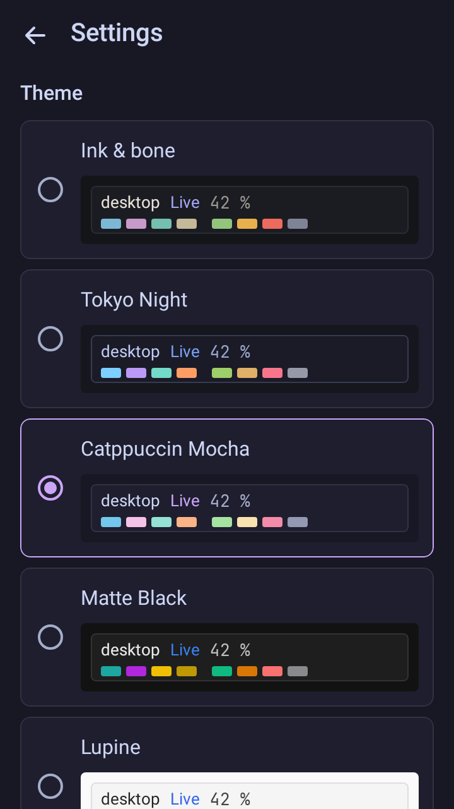

<div align="center">



**Anshin is a private health monitor for your own Linux Machines.** A tiny Agent on each Machine measures it; a native Android app shows every Machine live, with 30 minutes of charts, straight over your Tailscale tailnet. Nothing goes through a server, and nothing leaves your tailnet.

[](https://github.com/fsrodrig/anshin/actions/workflows/ci.yml)
[](https://github.com/fsrodrig/anshin/releases/latest)
[](LICENSE)

</div>

<p align="center">
  
  
  
  
</p>

<p align="center"><sub>Screenshots come from the app's screenshot tests and show made-up Machines and numbers.</sub></p>

Anshin (安心) means "peace of mind". It has two parts:

- **The Agent**, a small static Go program that runs on each Linux Machine. It takes a Sample every 2 s and keeps the last 30 minutes (the Window) in memory. It only reads; it never runs, changes or configures anything on the Machine.
- **The app**, a native Kotlin and Jetpack Compose app for Android. It connects straight to each Agent over the tailnet, and only while it is on screen.

Who gets in is decided by your tailnet identity: an Agent answers only the untagged devices of the tailnet user who owns its Machine. The phone sends no password or token.

## Features

- **One Dashboard for every Machine.** CPU, memory, primary disk and CPU temperature at a glance, plus battery on laptops, under the worst current Verdict.
- **A Verdict the Agent computes.** Each Machine is `ok`, `warn` or `crit`, with the Reasons behind it, such as `/ is 91 % full`.
- **Full charts the moment you look.** The Agent keeps the last 30 minutes, so a Machine opens with a full Window instead of an empty chart. Time the Machine spent asleep shows as a Gap, never filled in.
- **One screen per Machine.** Per-CPU usage and load, memory, swap and zram, btrfs-aware filesystems, disk and network rates, every temperature sensor, battery charge and state, uptime, distro and kernel.
- **Honest states.** A Machine that stops answering shows Stale or Unreachable with its age; a refused phone shows Forbidden; an answer in a Pulse version the app can't read shows Incompatible. A measurement the Machine doesn't have says so instead of showing `0`.
- **Quiet by design.** No background polling, no notifications. All traffic stops when Anshin is not on screen.
- **Six themes:** four dark, Ink & bone, Tokyo Night, Catppuccin Mocha and Matte Black, and two light, Lupine and Flexoki Light. Numbers use JetBrains Mono, and the layout stays readable at 200 % text size.

## Status

Anshin is **pre-1.0** and works toward its MVP: two Arch Linux Machines on one phone.

| Part | How you get it today |
|---|---|
| Agent | [GitHub Releases](https://github.com/fsrodrig/anshin/releases/latest) (`linux/amd64`, `linux/arm64`). The AUR package `anshin-agent-bin` is **pending**: the first release is built, but it isn't on the AUR yet. |
| App | **Build it from source** for now. No release carries an APK yet. The next release will, signed, and [Obtainium](https://obtainium.imranr.dev/) will update it from GitHub Releases: see [Installing Anshin](docs/install.md). |

Nothing in Anshin has been checked end to end on real hardware yet; [the security model](docs/security.md#not-yet-verified-on-real-hardware) says exactly what is and isn't tested. Work is tracked in [issues](../../issues).

## Requirements

- **Each Machine:** Linux on x86_64 or aarch64 with systemd, and [Tailscale](https://tailscale.com/download/linux) running and logged in as you. The Machine must not carry a tailnet tag.
- **The phone:** Android 8.0 or newer, with the Tailscale app logged in as the same tailnet user. The phone must not carry a tag either.
- **The tailnet policy** must let the phone reach TCP port 7247 on each Machine. Tailscale's default policy already does; to allow only your phone, see the [example policy](docs/security.md#an-example-policy).

## Install the Agent

### Arch Linux, from the AUR (pending)

> [!NOTE]
> `anshin-agent-bin` is not on the AUR yet. Until it is, build the same package from the release with the steps in the next section.

Once it is published, install it with your AUR helper:

```sh
paru -S anshin-agent-bin   # or: yay -S anshin-agent-bin
sudo systemctl enable --now anshin-agent
```

### Arch Linux, from the release (until the AUR package is published)

This renders the repository's PKGBUILD template with the release's checksums and builds the same `anshin-agent-bin` package the AUR will carry, so a later AUR update replaces it cleanly.

```sh
git clone https://github.com/fsrodrig/anshin.git && cd anshin
version=0.1.0   # the latest release, without the "v"
mkdir -p aur && cd aur
curl -fLO "https://github.com/fsrodrig/anshin/releases/download/v$version/checksums.txt"
../scripts/aur-render.sh "$version" checksums.txt > PKGBUILD
makepkg -si
sudo systemctl enable --now anshin-agent
```

`makepkg` downloads the archive for your architecture and refuses it unless its SHA-256 matches the release's `checksums.txt`.

### Other distributions, by hand

Each release archive holds the binary, the systemd unit and the license. Download the one for your architecture, check it, and install it under `/usr/local`:

```sh
version=0.1.0 arch=amd64   # or arch=arm64
base="https://github.com/fsrodrig/anshin/releases/download/v$version"
curl -fLO "$base/anshin-agent_${version}_linux_${arch}.tar.gz" -fLO "$base/checksums.txt"
sha256sum --check --ignore-missing checksums.txt
tar xzf "anshin-agent_${version}_linux_${arch}.tar.gz"

sudo install -Dm755 anshin-agent /usr/local/bin/anshin-agent
sed 's|/usr/bin/anshin-agent|/usr/local/bin/anshin-agent|' anshin-agent.service \
  | sudo tee /etc/systemd/system/anshin-agent.service > /dev/null
sudo systemctl daemon-reload
sudo systemctl enable --now anshin-agent
```

Every release archive is also attested by the workflow that built it. With the [GitHub CLI](https://cli.github.com/) you can check that it came from this repository's Release workflow:

```sh
gh attestation verify "anshin-agent_${version}_linux_${arch}.tar.gz" --repo fsrodrig/anshin
```

### Check it

```sh
anshin-agent doctor
```

The doctor explains in plain language what the Agent does on this Machine: whether tailscaled answers, whether the Machine is tagged, the addresses and port it binds, and which CPU sensor, batteries and filesystems it found. It exits 1 when something would stop the Agent serving your phone.

The service runs as an unprivileged, sandboxed user, listens only on the Machine's tailnet addresses (port 7247), and restarts by itself if tailscaled isn't ready yet. `systemctl status anshin-agent` and `journalctl -u anshin-agent` show what it is doing.

### Configure it

The Agent reads three optional environment variables. Set them with `sudo systemctl edit anshin-agent`, under `[Service]`:

```ini
[Service]
Environment="ANSHIN_PORT=7247"
Environment="ANSHIN_CPU_SENSOR=coretemp/Package id 0"
```

| Variable | Default | Meaning |
|---|---|---|
| `ANSHIN_PORT` | `7247` | TCP port on the tailnet addresses. Change it on the phone too, as `address:port`. |
| `ANSHIN_CPU_SENSOR` | chosen automatically | The CPU temperature sensor, as `<hwmon name>/<label>`. The Machine screen on the phone and `anshin-agent doctor` list every sensor. |
| `TAILSCALE_SOCKET` | `/run/tailscale/tailscaled.sock` | tailscaled's LocalAPI socket. |

There is no setting for the listen address, on purpose.

## Install the app

There is no prebuilt APK yet: [v0.1.0](https://github.com/fsrodrig/anshin/releases/tag/v0.1.0) has none. Until a release carries one, build a debug APK and install it over USB:

1. Set up the JDK and the Android SDK as described in [Developing § Phone](docs/develop.md#phone).
2. Build the APK:

   ```sh
   cd android && ./gradlew assembleDebug
   ```

3. Turn on USB debugging on the phone, connect it, and install:

   ```sh
   adb install -r app/build/outputs/apk/debug/app-debug.apk
   ```

> [!IMPORTANT]
> A release APK is signed with a different key from your debug build, so Android won't install it over the top. When a release carries one, uninstall the debug build first. Your saved Machines live only on the phone, so you'll add them again. [Installing Anshin § Switching](docs/install.md#switching-from-a-debug-or-self-built-apk) has the steps.

Once a release carries the signed APK, you'll add `https://github.com/fsrodrig/anshin` to Obtainium and get updates from GitHub Releases, with no store in between. [Installing Anshin](docs/install.md) has the steps and how to check the APK.

## Add your first Machine

1. Turn Tailscale on on the phone.
2. Open Anshin and tap **Add Machine**, the + in the Dashboard's bar (an empty Dashboard also shows an **Add Machine** button).
3. Give the Machine a name, and enter its MagicDNS name (such as `desktop.example.ts.net`) or its tailnet IP. Add `:port` only if you changed `ANSHIN_PORT`.
4. Tap **Save**. The Machine appears on the Dashboard and goes Live within a few seconds.

Repeat for each Machine. Tap a Machine to open its Machine screen; the gear in the Dashboard's bar opens **Settings**, with the theme picker, your Machines, and the licences.

## Troubleshooting

| The app shows | What it means | What to check |
|---|---|---|
| **Unreachable** | The phone got no Pulse. Anshin doesn't guess why. | Tailscale is on, on both ends; the address is right; the Agent is running (`systemctl status anshin-agent`); the tailnet policy lets the phone reach the port. If it says the Agent can't ask tailscaled who this phone is (HTTP 503), check `tailscale status` on the Machine. |
| **Forbidden** | The Agent answered and refused this phone. | The phone and the Machine are logged in as the same tailnet user, and neither carries a tag. `anshin-agent doctor` says whether the Machine is tagged. |
| **Incompatible** | The Agent answered in a version of the Pulse this app can't read. | Update Anshin and the Agent to their latest releases. |
| **Stale** | Answers stopped arriving. The numbers shown are old, with their age. | Whether the Machine is asleep or offline. |

For anything else, run `anshin-agent doctor` on the Machine.

## Uninstall

On each Machine:

```sh
sudo systemctl disable --now anshin-agent
sudo pacman -Rns anshin-agent-bin   # Arch
```

If you installed by hand, remove `/usr/local/bin/anshin-agent` and `/etc/systemd/system/anshin-agent.service` instead, then run `sudo systemctl daemon-reload`. On the phone, uninstall Anshin like any other app; it keeps nothing anywhere else.

## How it works

```text
 Phone (Anshin app)                         Machine
┌──────────────────┐   tailnet (WireGuard)  ┌────────────────────────────┐
│ Dashboard        │ ── GET /v1/pulse ────► │ anshin-agent               │
│ Machine screen   │ ◄── Pulse (JSON) ───── │  · reads /proc and /sys    │
│                  │   new Samples, only    │  · Sample every 2 s        │
│ tailnet-only     │   while on screen      │  · 30-minute Window in RAM │
│ HTTP client      │                        │  · WhoIs → allow or 403    │
└──────────────────┘                        └────────────┬───────────────┘
                                                         │ LocalAPI
                                                         ▼
                                                     tailscaled
```

- The Agent binds only its tailnet addresses and asks the local tailscaled who each caller is. Only the Owner's untagged devices get a Pulse; everyone else gets `403`.
- The phone's only HTTP client refuses any destination outside the tailnet's address ranges, ignores system proxies and never follows redirects.
- Nothing is stored off the phone or the Machine, and nothing leaves your tailnet.

The full design, its trade-offs and what is left over are in [the design](docs/design.md) and [the security model](docs/security.md).

## Documentation

- [Design](docs/design.md): how it's built, the Pulse contract and what each measurement means
- [Security model](docs/security.md): what Anshin trusts, who gets in, and the risks left over
- [Installing the app](docs/install.md): Obtainium, checking the APK and switching from a debug build
- [Developing](docs/develop.md): build, test and run both halves
- [Decisions](docs/adr/): why it's built this way
- [Glossary](GLOSSARY.md): the words Anshin uses
- [Branding](branding/README.md): logo, palette and app layouts
- [Original brief](docs/brief.md): where it started

## Contributing

Contributions are welcome. Read [CONTRIBUTING.md](CONTRIBUTING.md) first: it covers setup, the `make check` gate, pull request titles, and keeping the repository free of hostnames and other identifiers. For anything bigger than a fix, open an issue first.

Report security problems privately, as described in [SECURITY.md](SECURITY.md), never in a public issue.

## Acknowledgements

- [Tailscale](https://tailscale.com/), whose identity model Anshin relies on instead of adding its own.
- [Tokyo Night](https://github.com/tokyo-night/tokyo-night-vscode-theme), [Catppuccin](https://github.com/catppuccin/palette), [Omarchy](https://github.com/omacom/omarchy)'s Matte Black with [matteblack.nvim](https://github.com/tahayvr/matteblack.nvim), Omarchy's Lupine, and [Flexoki](https://github.com/kepano/flexoki), whose palettes the alternate themes adapt.
- [JetBrains Mono](https://www.jetbrains.com/lp/mono/), bundled under the SIL Open Font License.

Each theme's source and licence is listed in [branding/themes](branding/themes/README.md) and in the app under **Settings → Open-source licences**.

## License

[MIT](LICENSE)
